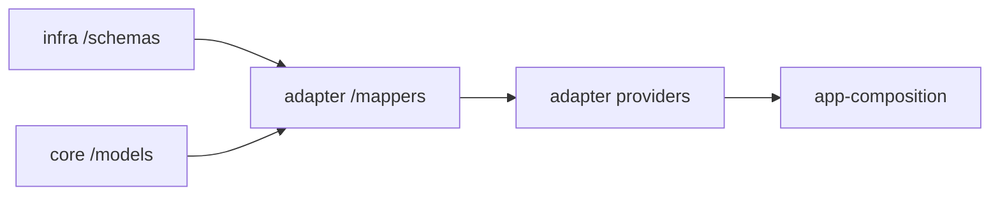

# Forma-oriented monorepo (TypeScript)

> **Audience:** Human developers and coding agents (LLMs).  
> **Purpose:** Canonical architecture for this repository. Agent skills under [`.skills/`](../.skills/) provide task-specific guides; **this file is the source of truth** when they differ.  
> **Agents editing skills:** modify only `.skills/<name>/SKILL.md` — never stub with “see canonical guide” links ([AGENTS.md](../AGENTS.md)).  
> **Scope:** Internal workspace packages under `apps/` and `packages/`. Not designed for publishing packages to npm.

---

## Quick reference (for agents)

| Package kind   | Folder                                    | npm name                         | Public entrypoints / import rules                                                                 |
| -------------- | ----------------------------------------- | -------------------------------- | ------------------------------------------------------------------------------------------------- |
| Core           | `packages/core-<feature>/`                | `@core/<feature>`                | `./models`, `./intents`, `./providers`, `./errors` only                                           |
| Infrastructure | `packages/infrastructure-<vendor>/`       | `@infrastructure/<vendor>`       | `./schemas`, `./intents`, `./providers`, `./errors`; **feature-agnostic**, vendor-specific        |
| Adapter        | `packages/adapter-<feature>-<vendor>[…]/` | `@adapter/<feature>-<vendor>[…]` | `./mappers`, `./intents`, `./providers`, `./errors`; depends on one core + its vendor stack        |
| UI             | `packages/ui-<name>/`                     | `@ui/<name>`                     | Root export; **only `apps/*` may import** (not a Forma boundary)                                  |
| App            | `apps/<app>/`                             | (app package)                    | Hosts `composition/`; runtime assembly only                                                       |

**Boundary rule:** for core, infrastructure, and adapter — **1 Forma boundary = 1 package**.

**Hard bans (ESLint):**

- Core MUST NOT import `@infrastructure/*`, `@adapter/*`, `@ui/*`, frameworks/SDKs, or `apps/*`.
- Infrastructure MUST NOT import `@core/*`, `@adapter/*`, or `@ui/*`.
- Adapter MAY import `@core/*/models|intents|errors` and its stack’s `@infrastructure/*/schemas|intents|errors`; MUST NOT import `/providers` except via composition.
- `/providers` is importable **only** from `apps/*/composition/**`.
- `/mappers` is importable from the **same adapter** and `apps/*/composition/**` — **not** non-composition apps or other package kinds.
- `/schemas` is importable from the **same-vendor** infra package, adapters of that stack, and composition — apps (non-composition) still must not import infra.
- Cross-core imports forbidden by default.
- `operations/` is **core-only** and has **no** public export — expose cross-boundary behavior via an intent (+ provide).

**Scaffolding:** `@xndrjs/plop-os` via `tools/plop/plopfile.ts` (root `plopfile.mjs` loader) — `pnpm plop` / `plop:run` / `plop:sync`.

---

## Goals

1. Organize the monorepo around **Forma** boundaries, intents, providers, bindings, and composition (`@xndrjs/forma`).
2. Enforce **package-kind** dependency rules with ESLint (directional import rules), orthogonal to Forma’s bind/indirection model.
3. Keep **adapters** as the only place that joins a feature (core) to a vendor stack (infrastructure).

---

## Forma vs ESLint (orthogonal)

| Layer      | Responsibility                                                                                |
| ---------- | --------------------------------------------------------------------------------------------- |
| **Forma**  | Intent identity, providers, `using` (same boundary), `bind` / `compose` / surface / lifetimes |
| **ESLint** | Which package kinds and entrypoints may import which                                          |

Forma does not replace import bans; ESLint does not replace composition bindings. ESLint config is hand-authored.

---

## Package taxonomy

| Kind           | Folder                                    | npm scope                        | Specificity                                   |
| -------------- | ----------------------------------------- | -------------------------------- | --------------------------------------------- |
| Core           | `packages/core-<feature>/`                | `@core/<feature>`                | Feature-specific, vendor-agnostic             |
| Infrastructure | `packages/infrastructure-<vendor>/`       | `@infrastructure/<vendor>`       | Feature-agnostic, vendor-specific             |
| Adapter        | `packages/adapter-<feature>-<vendor>[…]/` | `@adapter/<feature>-<vendor>[…]` | Feature-specific; stack = one or more vendors |
| UI             | `packages/ui-<name>/`                     | `@ui/<name>`                     | Shared UI; **not** a Forma boundary           |
| App            | `apps/<app>/`                             | app package                      | Deployable; hosts composition                 |

### Adapter naming

- Name = **feature + vendor stack** (explicit, concatenated).
- Mono-vendor: `adapter-pagebuilder-contentful`.
- Multi-vendor materializer (no IR): `adapter-pagebuilder-contentful-mulesoft`.
- Parallel stacks = separate packages (e.g. `…-datocms-workato`), never one god-package importing all vendors.
- No intermediate representation layer: the adapter may know vendor raw shapes; the unit of substitution is the whole adapter stack package.

### Infrastructure packaging

- Keep vendor/technology details in `@infrastructure/<vendor>`: clients, SDK bootstrap, raw fetch helpers, caching/batching.
- Shared vendor packages hold **reusable low-level building blocks only** — not feature orchestration or business rules.
- Feature-specific mapping and realization of core intents live in `@adapter/<feature>-<vendors…>/`, not in infrastructure.
- Extract shared primitives only when reuse appears across at least two adapter stacks; split large vendor packages by stable sub-capabilities, not by domain workflows.

### Fetch raw vs materialize (convention)

Not separate package kinds or generators — narrative roles on intents:

| Role        | Typical home                       | Responsibility                                           |
| ----------- | ---------------------------------- | -------------------------------------------------------- |
| Fetch raw   | Infrastructure intents / providers | Vendor-native shapes; batching/caching; no `@core/*`     |
| Materialize | Adapter intents / providers        | Map raw → core models; realize core (unrealized) intents |

The same raw fetch can feed multiple adapters (or multiple materializers) projecting into different `@core/*` read models.



---

## Target package layout

**Core** (`packages/core-<feature>/`):

```text
  models/              # domain-zod kits: *.primitive / *.shape / *.proof
  intents/             # *.intent.ts + optional sibling *.provider.ts
    index.intents.ts   # barrel: all *.intent.ts (plop-os sync)
    index.providers.ts # barrel: all *.provider.ts (plop-os sync)
  errors/              # *.error.ts
  operations/          # INTERNAL — *.capabilities.ts / *.service.ts (not an entrypoint)
  package.json         # exports: ./models, ./intents, ./providers, ./errors
```

**Infrastructure** (`packages/infrastructure-<vendor>/`):

```text
  schemas/             # plain Zod *.schema.ts (vendor/raw structural validation)
  intents/
    index.intents.ts
    index.providers.ts
  errors/
  package.json         # exports: ./schemas, ./intents, ./providers, ./errors — no operations/
```

**Adapter** (`packages/adapter-<feature>-<vendors…>/`):

```text
  mappers/             # *.mapper.ts — project infra raw → core models (no models/)
  intents/
    index.intents.ts
    index.providers.ts
  errors/
  package.json         # exports: ./mappers, ./intents, ./providers, ./errors — no operations/
```

`operations/` is **core-only**. Adapter and infrastructure scaffolds omit it. Adapters have **no** `models/` — mapping lives in `mappers/`.

### Entrypoints

| Export        | Who may import                                                                                                                                              |
| ------------- | ----------------------------------------------------------------------------------------------------------------------------------------------------------- |
| `/models`     | Core only. Same package; `adapter-*` → `@core/*/models`; composition/apps as needed. **Not** `infrastructure-*` → `@core/*`                                 |
| `/schemas`    | Same-vendor infra; adapters of that stack; composition. **Not** non-composition apps (apps still must not import infra)                                     |
| `/mappers`    | Same adapter + `apps/*/composition/**` only. **Not** non-composition apps; **not** other package kinds                                                      |
| `/intents`    | Other boundaries that need contracts; adapters import core intents; composition may import intents                                                          |
| `/providers`  | **Only** `apps/*/composition/**`                                                                                                                            |
| `/errors`     | Same rules as the kind’s primary data entrypoint for cross-package use                                                                                      |
| `/operations` | **None** (no public export). Cross-boundary or app-facing behavior → expose an **intent** whose provide calls into `operations/`                            |

### Intent files

- Contract: `intents/<name>.intent.ts`.
- Realization (optional): sibling `intents/<name>.provider.ts` with `Intent.provide…`.
- Unrealized = contract only; realized = contract + provider file.
- Barrels: `index.intents.ts` exports all `*.intent.ts`; `index.providers.ts` exports only `*.provider.ts` (kept by `pnpm plop:sync`).

### Models / schemas / mappers by package kind

| Kind               | Location / files                                                                                                                         |
| ------------------ | ---------------------------------------------------------------------------------------------------------------------------------------- |
| **Core**           | `models/` — domain kits (`@xndrjs/domain` / `domain-zod`): primitive → shape → proof; capabilities/services in `operations/`; errors under `errors/` |
| **Infrastructure** | `schemas/` — plain Zod `*.schema.ts` only — vendor/raw structural validation. **No** `@xndrjs/domain` (invariants / lifecycle belong in core)       |
| **Adapter**        | `mappers/` — `*.mapper.ts` projecting infra raw into **core** kits. **No** `models/`; **no** `@xndrjs/domain` / `domain-zod`                        |

Do not put business rules in infrastructure schemas.

### Capabilities / services

Live only under core `operations/`. If they must be reachable across boundaries or from the app surface, wrap them in an intent (+ provide).

---

## ESLint import matrix

| From ↓ / To →              | core                                                                      | infra                                              | adapter                         | ui      | `/providers`            |
| -------------------------- | ------------------------------------------------------------------------- | -------------------------------------------------- | ------------------------------- | ------- | ----------------------- |
| **core**                   | same feature / own entrypoints only                                       | no                                                 | no                              | no      | —                       |
| **infra**                  | no `@core/*`                                                              | same vendor ok (`/schemas`, intents, errors, …)    | no                              | no      | —                       |
| **adapter**                | `/models`, `/intents`, `/errors` of its core                              | stack `/schemas`, `/intents`, `/errors`            | same stack (incl. `/mappers`)   | no      | no (except composition) |
| **ui**                     | no                                                                        | no                                                 | no                              | ui only | —                       |
| **apps (non-composition)** | models / intents / errors (not operations); not infra; not `/providers`   | no                                                 | `/intents`, `/errors` only      | yes     | no                      |
| **apps/composition**       | models / intents / errors + `/providers` (not operations)                 | yes (`/schemas` … + `/providers`)                  | yes (`/mappers` … + `/providers`) | yes   | yes                     |

Implemented in [`tools/eslint-rules/boundaries/`](../tools/eslint-rules/boundaries/) (`boundaries` + `no-restricted-imports` + `check-file`); root `eslint.config.js` loads it via jiti. Cross-core imports: forbidden by default. `core-operations` is importable only from same-feature `core-intents` / `core-operations` — never from apps or composition.

---

## Repository layout

```txt
apps/
  <app>/
    composition/          # Forma compose roots (required for wiring)
    package.json

packages/
  core-<feature>/         # @core/<feature>
  infrastructure-<vendor>/
  adapter-<feature>-<vendor>/
  ui-<name>/              # @ui/<name> — apps only

tools/plop/               # generators + templates (@xndrjs/plop-os)
specs/                    # feature specs — not imported by code
  <feature>/
    SPEC.md
    DESIGN.md
```

---

## Composition

Owned by apps. Prefer **one composition file per runtime** of the app (server or client), not one per core feature. Runtime is always explicit — no isomorphic roots (`import "server-only"` / `import "client-only"`).

Wire with Forma `compose({ surface, providers, bindings })` and `bind(required, satisfier)`.

### Kinds

| Kind        | Marker                 | Typical file                  | Public export (example) |
| ----------- | ---------------------- | ----------------------------- | ----------------------- |
| server-only | `import "server-only"` | `<app>.server.composition.ts` | `get…ServerRoot`        |
| client-only | `import "client-only"` | `<app>.client.composition.ts` | `get…ClientRoot`        |

```txt
apps/<app>/
  composition/
    <app>.server.composition.ts   # server
    <app>.client.composition.ts   # client
```

Call sites (routes, handlers, UI) import the root from composition — not providers or infrastructure factories directly.

| Actor                   | Allowed imports                                                                                                                                                                                      |
| ----------------------- | ---------------------------------------------------------------------------------------------------------------------------------------------------------------------------------------------------- |
| `apps/*/composition/**` | `@core/*/models\|intents\|errors\|providers` (not operations), `@infrastructure/*` (incl. `/schemas` + `/providers`), `@adapter/*` (incl. `/mappers` + `/providers`), `@ui/*`, app code               |
| Rest of app             | `@core/*/models\|intents\|errors`, `@adapter/*/intents\|errors`, `@ui/*`, composition roots; **not** `/providers`, **not** `/mappers`, **not** infrastructure, **not** operations                      |
| `@core/*`               | MUST NOT import apps, infrastructure, adapter, or UI                                                                                                                                                 |
| `@infrastructure/*`     | MUST NOT import `@core/*` or orchestrate app composition                                                                                                                                             |
| `@adapter/*`            | Core models/intents/errors + its infra stack (`/schemas`, `/intents`, `/errors`)                                                                                                                     |
| `@ui/*`                 | Consumed from apps only (including composition)                                                                                                                                                      |

---

## Specs

See [specification-driven-feature-workflow.md](./specification-driven-feature-workflow.md).

| Path                        | Role                                                                                   |
| --------------------------- | -------------------------------------------------------------------------------------- |
| `specs/SPEC-MAP.md`         | Optional product ToC of capabilities                                                   |
| `specs/<feature>/SPEC.md`   | What/why — domain language only                                                        |
| `specs/<feature>/DESIGN.md` | How — to-be inventory in Forma vocabulary (boundaries, intents, adapters, composition) |

---

## Applications (`apps/`)

Deployable or runnable targets: Next.js, React SPA, CLI, workers, API servers. Apps perform final bundling and runtime assembly; they do not own domain rules.

Root `tsconfig.json` is a solution config (`files: []` + `references`). The `references` array is a plop-os sync region (`root-tsconfig-refs`); run `pnpm plop:sync` after adding/removing packages or apps.

App scaffolds use `app-tsconfig.json.hbs` (`composite` + `noEmit: true`). Boundary/UI packages use `package-tsconfig.json.hbs` (`emitDeclarationOnly`).

---

## Dependency notes

| Package                         | Role                                                                              |
| ------------------------------- | --------------------------------------------------------------------------------- |
| `@xndrjs/forma`                 | Composition runtime for apps (and types/helpers as needed in packages)            |
| `@xndrjs/domain` / `domain-zod` | Domain kits in **core** only — not adapter or infrastructure                      |
| `@xndrjs/plop-os`               | Scaffold + sync (`pnpm plop` / `plop:run` / `plop:sync`)                          |
| `zod`                           | Plain schemas in infrastructure `schemas/`; also via domain-zod in core           |

---

## Related docs

| Doc                                                                                    | Role                              |
| -------------------------------------------------------------------------------------- | --------------------------------- |
| [specification-driven-feature-workflow.md](./specification-driven-feature-workflow.md) | Lean SPEC.md / DESIGN.md workflow |
| [AGENTS.md](../AGENTS.md)                                                              | Agent entrypoint + skill map      |
